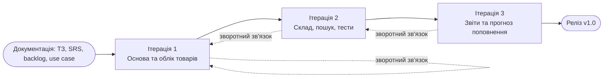

# Ітерації розробки — My Shop

Проєкт розбито на 3 ітерації за принципами спіральної моделі: кожна ітерація
проходить цикл «планування → аналіз ризиків → розробка і перевірка → оцінка
результату» і завершується працюючою версією, яку можна показати керівнику.

Документація (ТЗ, SRS, backlog, use case) підготовлена до початку розробки,
а реалізація йде інкрементами, тобто підхід поєднує каскадну та ітеративну моделі.

## Дорожня карта

---

## Ітерація 1. Основа та облік товарів

**Мета:** отримати мінімально працюючу систему з розділенням на шари і
повним керуванням картками товарів.

**Вимоги:** FR-1 (додавання, редагування, видалення товарів), NFR-1, NFR-3.

**Результат:**
- база даних SQLite зі схемою;
- список товарів і форма додавання з валідацією;
- редагування та видалення товарів;

**Ризики:**

| Ризик | Ймовірність | Як зменшуємо |
|---|---|---|
| Конфлікти під час першого `git push` | Середня | `git pull --allow-unrelated-histories`, `.gitignore` для БД |
| Помилки в архітектурі, які дорого виправляти пізніше | Середня | Розділення шарів з першого кроку |

**Критерій завершення:** товар можна додати, змінити та видалити, помилки
валідації показуються у формі.

---

## Ітерація 2. Склад, пошук і тестування

**Мета:** додати рух товару на складі та інструменти для швидкого пошуку,
покрити основну логіку тестами.

**Вимоги:** FR-2, FR-3, FR-4, NFR-1.

**Результат:**
- категорії та постачальники;
- реєстрація надходжень і списань з історією операцій;
- пошук за назвою/SKU, фільтрація, сортування;
- 5-10 unit-тестів, зокрема негативний сценарій.

**Ризики:**

| Ризик | Ймовірність | Як зменшуємо |
|---|---|---|
| Некоректний залишок (списання більше за наявне, неузгодженість запису операції та залишку) | Середня | Перевірка в сервісі, запис операції й оновлення залишку в одній транзакції |
| SQL-ін'єкції у фільтрах і сортуванні | Середня | Підготовлені запити, білий список полів сортування |
| Збільшення складності без тестів | Висока | Тести пишуться разом з логікою складу |
| PHPUnit не встановлюється без Composer | Висока | Запуск тестів на машині, де є Composer |

**Критерій завершення:** операції зі складом працюють коректно, тести проходять.

---

## Ітерація 3. Звіти та прогноз поповнення

**Мета:** реалізувати компонент, що виходить за межі звичайного обліку, і
завершити документацію.

**Вимоги:** FR-5, FR-6, NFR-2.

**Результат:**
- зведений звіт: кількість позицій, вартість запасів, товари з низьким залишком;
- прогноз вичерпання запасу за швидкістю продажів і рекомендована кількість
  до замовлення;
- тести для прогнозу;
- UML-діаграми (Class, Sequence, Activity), оновлений README.

**Ризики:**

| Ризик | Ймовірність | Як зменшуємо |
|---|---|---|
| Неточність простої моделі прогнозування | Середня | Чітко описати припущення |

**Критерій завершення:** сторінка рекомендацій показує товари з кількістю
до замовлення, тести проходять, документація актуальна.

---

## Зв'язок зі спіральною моделлю

| Квадрант | Як застосовується у проєкті |
|---|---|
| Планування | Вибір вимог для ітерації з ТЗ та backlog |
| Аналіз ризиків | Таблиці ризиків вище, перед початком кожної ітерації |
| Розробка і перевірка | Код, тести, перевірка критерію завершення |
| Оцінка замовником | Демонстрація керівнику, правки йдуть у наступну ітерацію |

## Роль прототипів

Після першої ітерації вже є робочий прототип (список і форма), на якому
перевіряється зручність інтерфейсу до того, як буде складніша логіка.